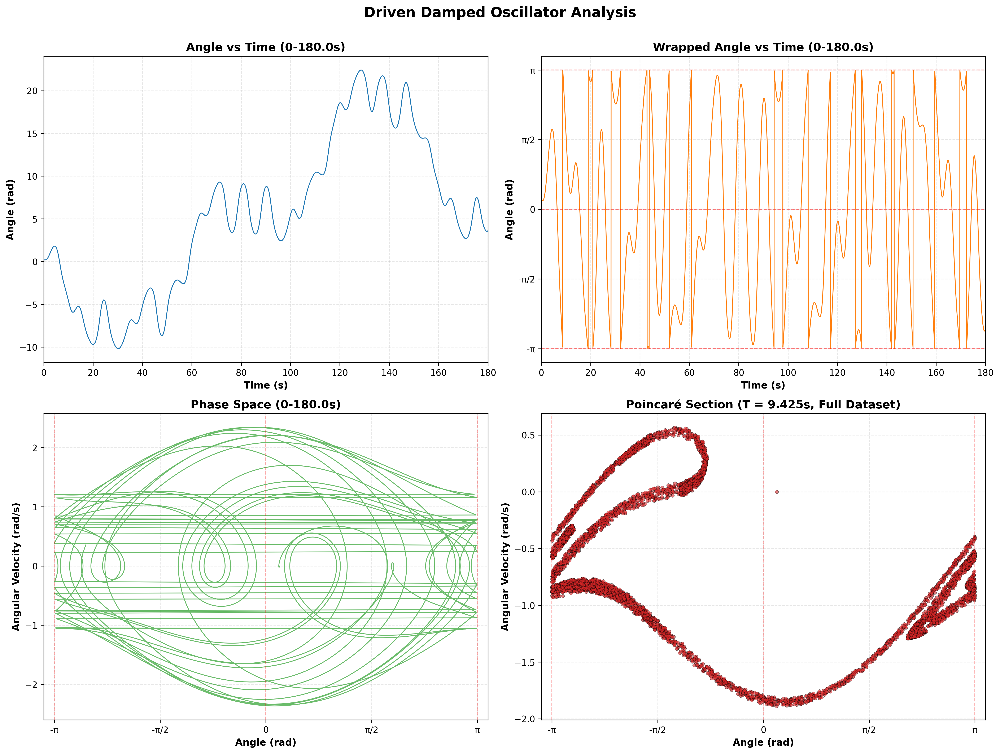
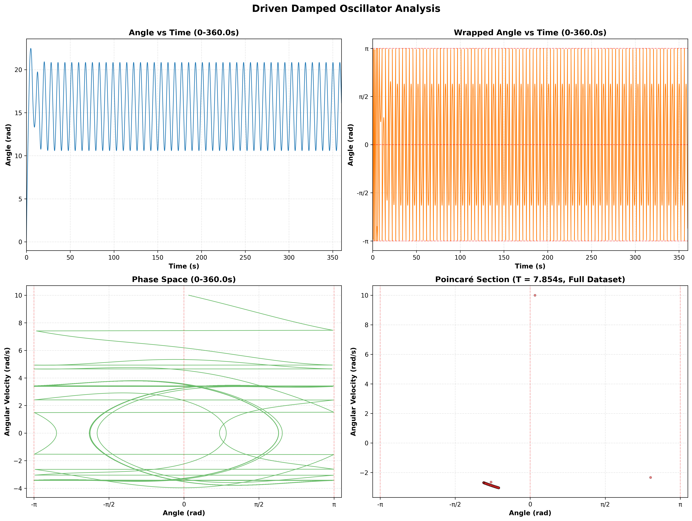

<p align="center">
  <a href="https://nels.buhrley.com/CPP-Numerical-Modeling/#academic-projects"><strong>← Back to Portfolio Hub</strong></a>
</p>

# Project 2: Driven Damped Pendulum — Route to Chaos

> [!TIP]
> Every highlighted link in this page is clickable.
> For fast navagation use [Table of Contents](#table-of-contents)


**Author:** Nels Buhrley
**Language:** C++17 · Python 3 (visualization)
**Build:** `make release` — see [Build & Run](#build--run)

---

## Snapshot

- Built a nonlinear dynamics simulator for the driven damped pendulum, capturing transitions from periodic motion to deterministic chaos.
- Implemented and compared RK4 and Euler-Cromer integrators to evaluate stability, accuracy, and qualitative phase-space behavior.
- Generated phase portraits and Poincare sections to identify attractors, bifurcations, and chaotic regimes.
- Demonstrates depth in numerical ODE methods, dynamical systems analysis, and scientific visualization.

For a fast technical check, jump to [Numerical Methods](#numerical-methods) and [Results](#results).

---

## Table of Contents

- [Snapshot](#snapshot)
- [Overview](#overview)
- [Physics Background](#physics-background)
  - [Equation of Motion](#equation-of-motion)
  - [Natural Frequency and Resonance](#natural-frequency-and-resonance)
  - [Phase Space and Attractors](#phase-space-and-attractors)
  - [Poincaré Sections](#poincaré-sections)
- [Numerical Methods](#numerical-methods)
  - [4th-Order Runge-Kutta (RK4)](#4th-order-runge-kutta-rk4)
  - [Euler-Cromer (Semi-Implicit Euler)](#euler-cromer-semi-implicit-euler)
  - [Derivative Computation](#derivative-computation)
- [Code Structure](#code-structure)
  - [Simulation Modes](#simulation-modes)
- [Results](#results)
- [Sources of Error](#sources-of-error)
- [Build & Run](#build--run)
  - [Prerequisites](#prerequisites)
  - [Build](#build)
  - [Run](#run)
  - [Visualize](#visualize)
- [Example Parameter Sets](#example-parameter-sets)
  - [Periodic Regime](#periodic-regime)
  - [Chaotic Regime (Period Doubling)](#chaotic-regime-period-doubling)
  - [Deep Chaos](#deep-chaos)
- [Key Techniques](#key-techniques)
- [Project Structure](#project-structure)

---

## Overview

This project simulates a **driven damped pendulum** — one of the simplest physical systems that can exhibit **deterministic chaos**. By varying the driving force amplitude, the pendulum transitions from regular periodic motion through period-doubling cascades into fully chaotic dynamics. The simulation implements both **4th-order Runge-Kutta (RK4)** and **Euler-Cromer (semi-implicit Euler)** integrators, and the Python visualization produces six-panel analysis figures including **phase-space portraits** and **Poincaré sections** for identifying chaotic attractors.

---

## Physics Background

### Equation of Motion

The angular displacement $\theta(t)$ of a driven damped pendulum of length $L$ and mass $m$ obeys the nonlinear second-order ODE:

$$\ddot{\theta} + \frac{q}{m}\dot{\theta} + \frac{g}{L}\sin\theta = \frac{F_D}{m}\sin(\omega_D t)$$

| Term | Physics |
|---|---|
| $\ddot{\theta}$ | Angular acceleration |
| $(q/m)\dot{\theta}$ | Viscous damping — opposes angular velocity |
| $(g/L)\sin\theta$ | Gravitational restoring torque — **nonlinear** |
| $(F_D/m)\sin(\omega_D t)$ | Periodic driving force |

The nonlinearity comes entirely from the $\sin\theta$ term. For small angles ($\sin\theta \approx \theta$) the system reduces to a linear driven harmonic oscillator with well-known analytic solutions. But at large amplitudes the full $\sin\theta$ coupling to the drive produces qualitatively new dynamics.

### Natural Frequency and Resonance

The small-angle natural frequency is:

$$\omega_0 = \sqrt{\frac{g}{L}}$$

When $\omega_D \approx \omega_0$ and damping is moderate, the system resonates and the amplitude grows until limited by nonlinear effects. The interplay between resonance, nonlinearity, and driving gives rise to the rich dynamical behavior this simulation explores.

### Phase Space and Attractors

The state of the pendulum at any instant is fully specified by $(\theta, \dot{\theta})$. Plotting $\dot{\theta}$ versus $\theta$ yields the **phase-space portrait**:

- **Periodic motion** appears as a **closed loop** (limit cycle)
- **Period-$n$ motion** produces $n$ loops that overlap after $n$ drive periods
- **Chaotic motion** fills a region densely without repeating — a **strange attractor**

### Poincaré Sections

A Poincaré section captures the phase-space state $(\theta, \dot{\theta})$ at stroboscopic intervals $t_n = n \cdot 2\pi/\omega_D$, sampling exactly once per driving period:

- **Period-1 motion** → a single point
- **Period-2 motion** → two points
- **Chaos** → a fractal dust of points — the hallmark of a strange attractor

This stroboscopic sampling collapses the trajectory from a continuous curve to a discrete map, making the distinction between periodic and chaotic regimes immediately visible.

---

## Numerical Methods

### 4th-Order Runge-Kutta (RK4)

For a state vector $\vec{y} = (t, \theta, \dot{\theta})$, the RK4 scheme computes:

$$\vec{y}_{n+1} = \vec{y}_n + \frac{h}{6}(\vec{k}_1 + 2\vec{k}_2 + 2\vec{k}_3 + \vec{k}_4)$$

where each $\vec{k}_i$ evaluates the derivative function at a different point in the interval. This achieves $\mathcal{O}(h^4)$ global error and is used for custom simulations where accuracy is paramount.

### Euler-Cromer (Semi-Implicit Euler)

The Euler-Cromer method updates velocity first, then uses the *new* velocity to update position:

$$\dot{\theta}_{n+1} = \dot{\theta}_n + \ddot{\theta}_n \cdot h$$
$$\theta_{n+1} = \theta_n + \dot{\theta}_{n+1} \cdot h$$

This ordering makes the method **symplectic** — it preserves the phase-space area (Liouville's theorem) and provides much better energy conservation than the standard (forward) Euler method. Global error is $\mathcal{O}(h)$, but the qualitative dynamics (orbit topology, bifurcation thresholds) are captured correctly even at moderate step sizes. The validation tests use Euler-Cromer with $dt = 0.001$ s over 72,000 seconds (20 hours of physical time).

### Derivative Computation

The `oscillator::computeDerivatives()` method evaluates:

$$\frac{d}{dt}\begin{pmatrix}t \\ \theta \\ \dot{\theta}\end{pmatrix} = \begin{pmatrix}1 \\ \dot{\theta} \\ -\frac{g}{L}\sin\theta - \frac{q}{m}\dot{\theta} + \frac{F_D}{m}\sin(\omega_D t)\end{pmatrix}$$

---

## Code Structure

| File | Role |
|---|---|
| `main.cpp` | Entry point — instantiates `logic` and calls `run()` |
| `include/oscillator.h` | `oscillator` class (physical parameters) and `testOscillator` subclass |
| `include/processing.h` | Declares `integrator::rk4()`, `integrator::euler_chromer()`, `logic` class |
| `src/oscillator.cpp` | Implements derivative computation: gravity + damping + driving |
| `src/processing.cpp` | RK4/Euler-Cromer implementation, interactive menu, CSV output |
| `plotting.py` | Six-panel analysis: time series, phase space, Poincaré sections |

### Simulation Modes

The `logic` class provides:
- **Validation tests** — predefined parameters with known behavior (periodic, chaotic)
- **Custom simulations** — user-specified parameters with RK4 integration
- Automatic CSV export and optional Python visualization invocation

---

## Results

<p align="center">
  
</p>

*Six-panel analysis of the driven damped pendulum. Top row: angle vs. time (unwrapped and wrapped to $[-\pi, \pi]$). Middle: full phase-space portrait. Bottom: Poincaré sections at the driving frequency reveal the attractor structure — periodic orbits appear as discrete points, chaotic dynamics as fractal dust.*

<p align="center">
  
  
</p>

<p align="center">
  
  
</p>

*Different parameter regimes: varying the driving force amplitude $F_D/m$ reveals transitions from periodic motion to chaos through period-doubling bifurcations.*

---

## Sources of Error

| Source | Nature | Mitigation |
|---|---|---|
| **Temporal truncation** | RK4: $\mathcal{O}(h^4)$; Euler-Cromer: $\mathcal{O}(h)$ | Small time steps ($dt = 0.001$ s or less) |
| **Sensitivity to initial conditions** | Chaotic trajectories diverge exponentially: $\lvert\delta\theta(t)\rvert \sim e^{\lambda t}$ | This is physics, not a bug — Lyapunov exponent $\lambda > 0$ defines chaos |
| **Angle wrapping artifacts** | Wrapping $\theta$ to $[-\pi, \pi]$ creates visual discontinuities | Unwrapped angle also recorded; wrapping applied only for phase-space visualization |
| **Poincaré timing** | Stroboscopic samples at $t = n \cdot 2\pi/\omega_D$ may not land exactly on a time step | Nearest-step sampling; small $dt$ minimizes interpolation error |
| **Symplecticity (RK4)** | RK4 is not symplectic — energy drifts over very long integrations | Euler-Cromer used for long validation runs; RK4 used when accuracy matters more than conservation |

---

## Build & Run

### Prerequisites

- **C++17** compatible compiler (`g++` or `clang++`)
- **Python 3** with `pandas`, `numpy`, and `matplotlib`

### Build

```bash
make release    # Optimized build (-O2)
make debug      # Debug build with full warnings
make clean      # Remove build artifacts
```

### Run

```bash
./bin/main
```

The program prompts for simulation mode (validation or custom) and parameters.

### Visualize

```bash
python3 plotting.py
```

The plotting script auto-detects output files in `Output/` and generates six-panel analysis figures saved as `Output/oscillator_analysis_N.png`.

---

## Example Parameter Sets

### Periodic Regime
- $q/m = 0.5\\ g/L = 9.8 \\ F_D/m = 0.5 \\ \omega_D = 0.667$ rad/s

### Chaotic Regime (Period Doubling)
- $q/m = 0.5\\ g/L = 9.8\\ F_D/m = 1.2\\ \omega_D = 0.667$ rad/s

### Deep Chaos
- $q/m = 0.5\\ g/L = 9.8\\ F_D/m = 1.5\\ \omega_D = 0.667$ rad/s

---

## Key Techniques

| Technique | Purpose |
|---|---|
| RK4 integration | High-accuracy ODE solving for custom simulations |
| Euler-Cromer integration | Symplectic method for long-duration energy-conserving runs |
| Phase-space portraits | Visualize attractor topology |
| Poincaré sections | Stroboscopic sampling reveals periodic vs. chaotic dynamics |
| Angle wrapping to $[-\pi, \pi]$ | Canonically bounded phase-space representation |
| Interactive parameter input | Explore bifurcation structure by tuning $F_D$, $\omega_D$, $q$ |

---

## Project Structure

```
Project 2: driven damped oscillations/
|-- main.cpp              # Entry point
|-- include/
|   |-- oscillator.h      # Oscillator class: physical parameters, derivatives
|   `-- processing.h      # Integrators (RK4, Euler-Cromer), logic controller
|-- src/
|   |-- oscillator.cpp    # Derivative computation: gravity + damping + driving
|   `-- processing.cpp    # Integration loops, interactive menu, CSV output
|-- plotting.py           # Six-panel analysis: time series, phase space, Poincare
|-- Makefile              # Build targets: release, debug, clean
|-- bin/                  # Compiled executables
`-- Output/               # CSV data and PNG analysis figures
```

---

*Nels Buhrley — Computational Physics, 2025*

<p align="center">
  <a href="https://nels.buhrley.com/CPP-Numerical-Modeling/#academic-projects"><strong>← Back to Portfolio Hub</strong></a>
</p>
