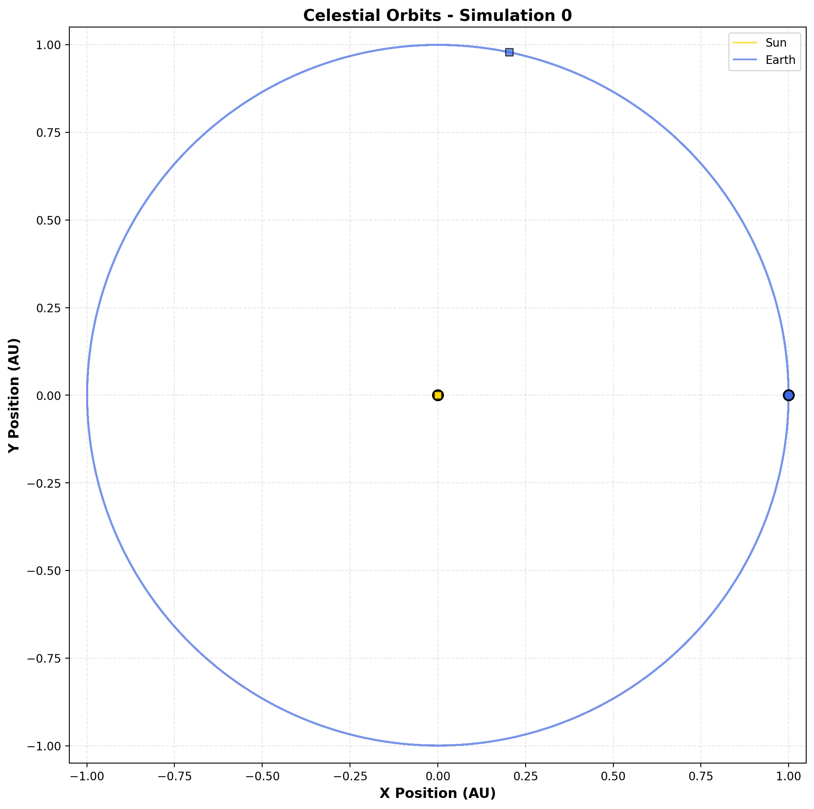
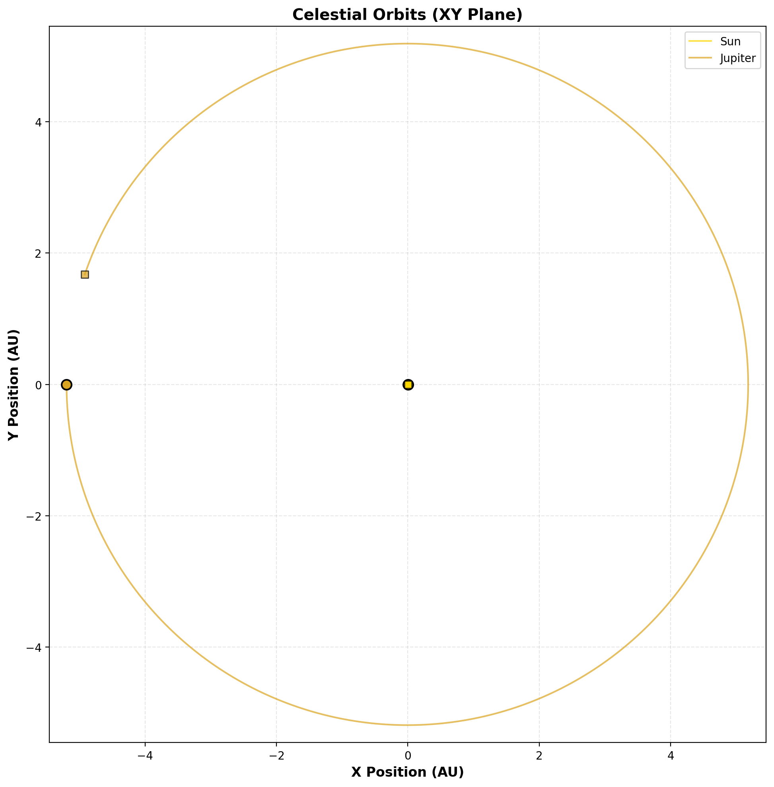
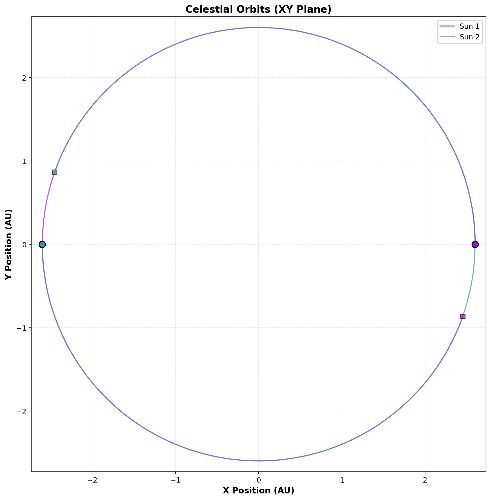
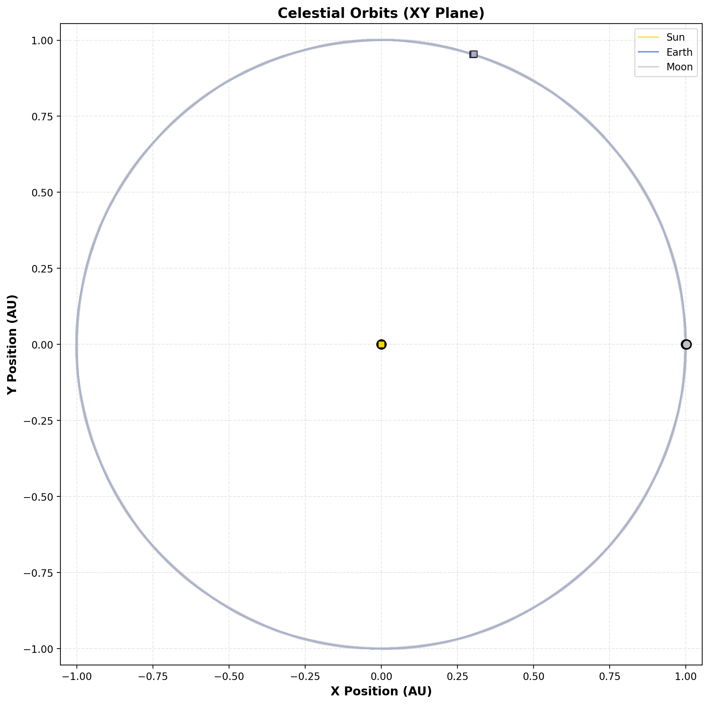
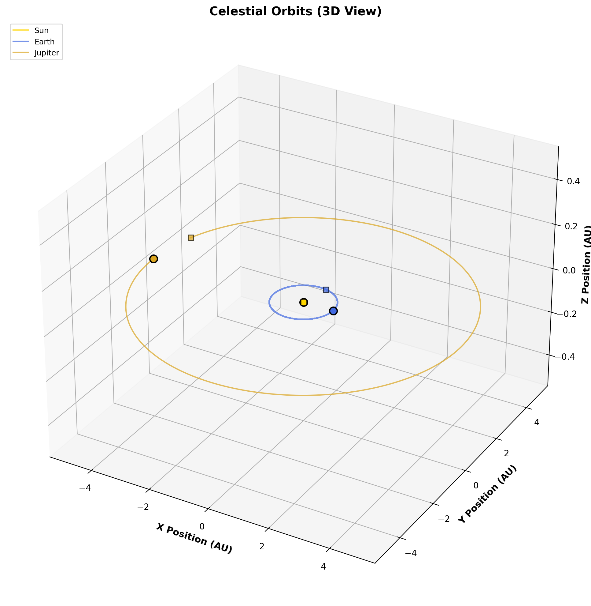
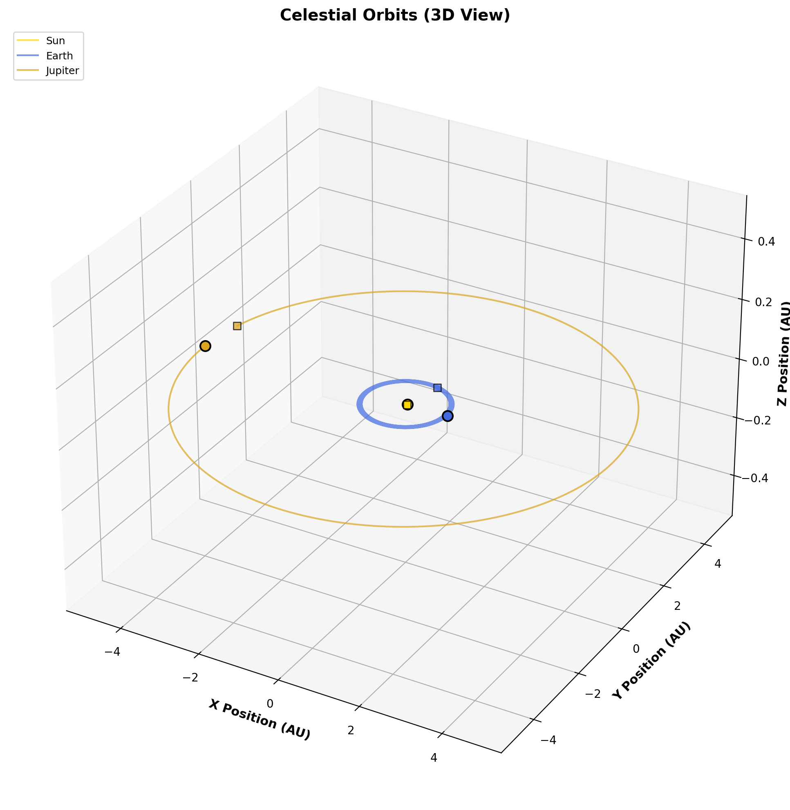
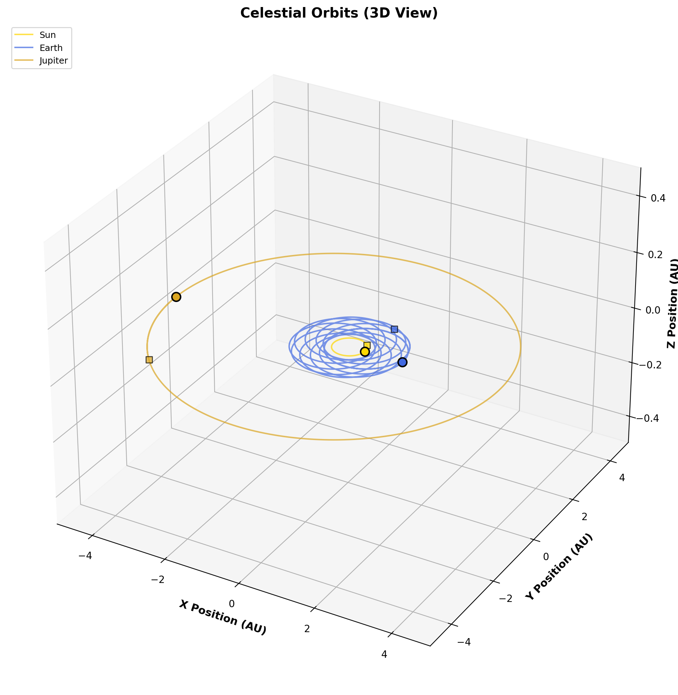
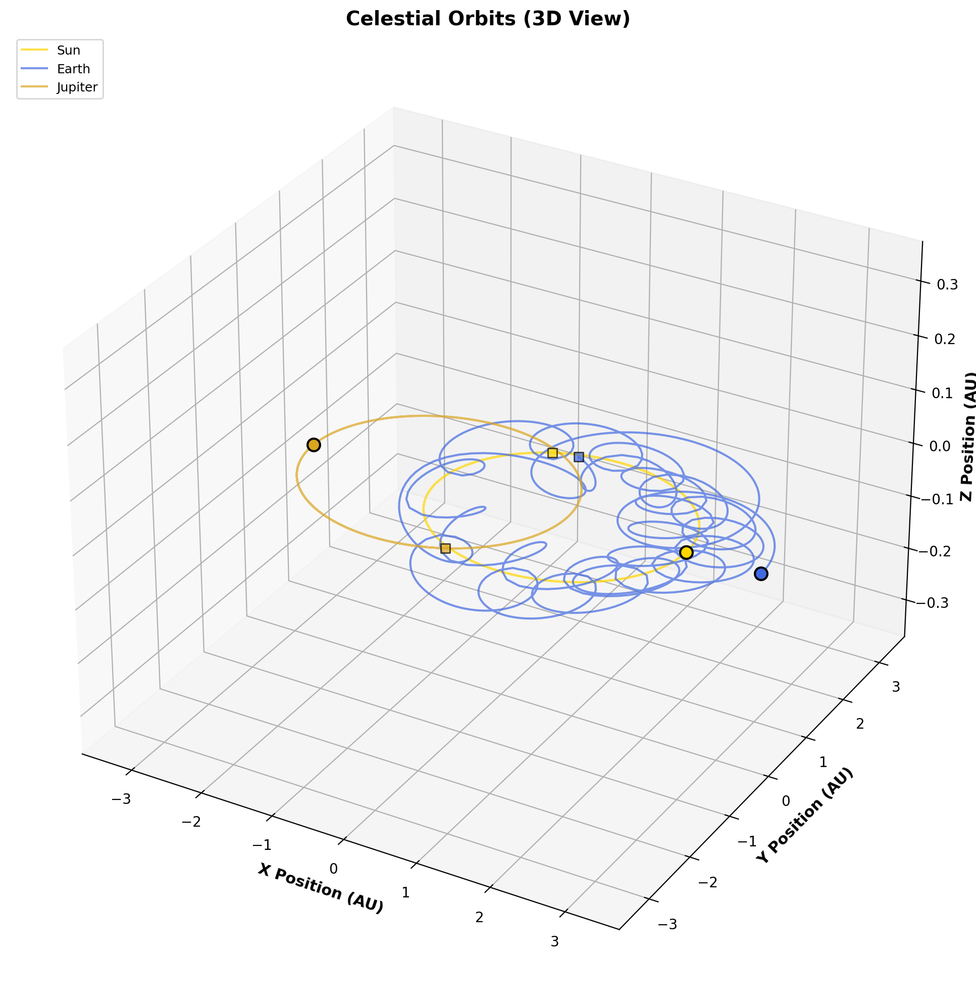

<p align="center">
  <a href="https://nels.buhrley.com/CPP-Numerical-Modeling/#academic-projects"><strong>← Back to Portfolio Hub</strong></a>
</p>

# Project 3: Celestial Dynamics — N-Body Gravitational Simulation

> [!TIP]
> Every highlighted link in this page is clickable.
> For fast navagation use [Table of Contents](#table-of-contents)


**Author:** Nels Buhrley
**Language:** C++17 · Python 3 (visualization)
**Build:** `make` — see [Build & Run](#build--run)

---

## Snapshot

- Implemented an N-body gravitational simulator in C++17 with multiple integrators (RK4, Euler-Cromer, Stormer-Verlet) for accuracy/energy-conservation tradeoff studies.
- Modeled realistic multi-body systems including full Solar System datasets in astronomical units.
- Built a Python rendering pipeline for 2D/3D orbit plots and animations to evaluate long-horizon trajectory behavior.
- Demonstrates competency in numerical integration, multi-body simulation, and validation through comparative methods.

For a fast technical check, jump to [Numerical Methods](#numerical-methods) and [Build & Run](#build--run).

---

## Table of Contents

- [Snapshot](#snapshot)
- [Overview](#overview)
- [Physics Background](#physics-background)
  - [Newton's Law of Gravitation](#newtons-law-of-gravitation)
  - [Conservation Laws](#conservation-laws)
  - [Center-of-Mass Frame](#center-of-mass-frame)
- [Numerical Methods](#numerical-methods)
  - [4th-Order Runge-Kutta (RK4)](#4th-order-runge-kutta-rk4)
  - [Euler-Cromer (Semi-Implicit Euler)](#euler-cromer-semi-implicit-euler)
  - [Störmer-Verlet](#störmer-verlet)
- [Code Structure](#code-structure)
  - [Built-In Solar System Data](#built-in-solar-system-data)
  - [Simulation Modes](#simulation-modes)
- [Results](#results)
  - [2D Orbit Plots](#2d-orbit-plots)
  - [3D Orbit Plots](#3d-orbit-plots)
  - [Orbit Animation](#orbit-animation)
- [Sources of Error](#sources-of-error)
- [Build & Run](#build--run)
  - [Prerequisites](#prerequisites)
  - [Build](#build)
  - [Run](#run)
  - [Visualize](#visualize)
- [Simulation Parameters](#simulation-parameters)
  - [Recommended Settings](#recommended-settings)
- [Key Techniques](#key-techniques)
- [Project Structure](#project-structure)

---

## Overview

This project implements an **N-body gravitational simulation** capable of evolving planetary systems, binary stars, and the full Solar System with moons. Three independent numerical integrators — **4th-order Runge-Kutta (RK4)**, **Euler-Cromer**, and **Störmer-Verlet** — are provided, allowing direct comparison of accuracy and energy conservation properties. The simulation uses **astronomical units** (AU, solar masses, years) and includes a complete built-in dataset for the Sun, all nine planets, and seven major moons.

A rich Python visualization pipeline generates both **2D and 3D static orbit plots** and **animated orbit videos** with configurable trail effects.

---

## Physics Background

### Newton's Law of Gravitation

Each body $i$ of mass $m_i$ at position $\vec{r}_i$ experiences a gravitational acceleration due to all other bodies:

$$\ddot{\vec{r}}_i = \sum_{j \neq i} \frac{G m_j (\vec{r}_j - \vec{r}_i)}{|\vec{r}_j - \vec{r}_i|^3}$$

where $G$ is Newton's gravitational constant. In computational units of AU, solar masses, and years:

$$G = 4\pi^2 \;\text{AU}^3 \;\text{M}_\odot^{-1} \;\text{yr}^{-2}$$

This choice of units simplifies the arithmetic: Earth orbits the Sun at ~1 AU with period ~1 year, and the gravitational constant is a small integer multiple of $\pi^2$.

### Conservation Laws

An isolated N-body system conserves:
- **Total energy** $E = T + V$ (kinetic + gravitational potential)
- **Total momentum** $\vec{P} = \sum_i m_i \vec{v}_i$
- **Total angular momentum** $\vec{L} = \sum_i m_i (\vec{r}_i \times \vec{v}_i)$

Symplectic integrators (Euler-Cromer, Verlet) preserve these quantities much better than non-symplectic methods (RK4) over long timescales. This makes integrator choice physically meaningful, not just a numerical preference.

### Center-of-Mass Frame

When bodies are added to a `CelestialSystem`, the code automatically translates positions and velocities so that the center of mass is at rest at the origin:

$$\vec{r}_i \leftarrow \vec{r}_i - \frac{\sum_j m_j \vec{r}_j}{\sum_j m_j}, \qquad \vec{v}_i \leftarrow \vec{v}_i - \frac{\sum_j m_j \vec{v}_j}{\sum_j m_j}$$

This prevents the entire system from drifting and ensures that the simulation frame is inertial.

---

## Numerical Methods

### 4th-Order Runge-Kutta (RK4)

The state vector $\vec{y} = (t, \vec{r}_1, \vec{v}_1, \vec{r}_2, \vec{v}_2, \ldots)$ is advanced via the classical four-stage formula:

$$\vec{y}_{n+1} = \vec{y}_n + \frac{h}{6}(\vec{k}_1 + 2\vec{k}_2 + 2\vec{k}_3 + \vec{k}_4)$$

- **Global error:** $\mathcal{O}(h^4)$
- **Symplectic:** No — energy drifts secularly over long integrations
- **Best for:** Short, high-accuracy simulations where energy drift is acceptable

### Euler-Cromer (Semi-Implicit Euler)

Updates velocities first using current accelerations, then positions using the *new* velocities:

$$\vec{v}_{n+1} = \vec{v}_n + \vec{a}_n \cdot h$$
$$\vec{r}_{n+1} = \vec{r}_n + \vec{v}_{n+1} \cdot h$$

- **Global error:** $\mathcal{O}(h)$ — first-order accurate
- **Symplectic:** Yes — preserves phase-space volume
- **Best for:** Long-duration integrations (millions of years) where energy conservation matters more than step-by-step accuracy

### Störmer-Verlet

A second-order symplectic method that uses only positions (no explicit velocities in the state):

$$\vec{r}_{n+1} = 2\vec{r}_n - \vec{r}_{n-1} + \vec{a}_n \cdot h^2$$

- **Global error:** $\mathcal{O}(h^2)$
- **Symplectic:** Yes — excellent long-term energy conservation
- **Bootstrap:** Requires $\vec{r}_{-1}$ to start. This is computed by a single **backward RK4 step** from the initial conditions via `initializeVerletPreviousState()`, which builds a combined position-velocity state, steps backward by $-h$ using RK4, and extracts the resulting positions.

All three integrators are implemented as **template functions** in the `integrator` namespace, accepting generic state types and function objects for derivatives/accelerations.

---

## Code Structure

All code is **header-only** (the `src/` directory is empty):

| File | Role |
|---|---|
| `main.cpp` | Entry point — creates `Run` instance |
| `include/objects.h` | `CelestialObject` (mass, position, velocity, gravity) and `CelestialSystem` (N-body collection, force computation, state-vector conversion) |
| `include/processing.h` | `integrator::rk4()`, `integrator::euler_chromer()`, `integrator::verlet()`, `integrator::initializeVerletPreviousState()` |
| `include/run.h` | Interactive `Run` class: menus, Solar System data, simulation execution, CSV output |
| `plotting.py` | 2D/3D static plots + animated orbit videos (729 lines) |

### Built-In Solar System Data

The `Run` class contains hardcoded orbital elements for:

| Object | Mass (M☉) | Source |
|---|---|---|
| Sun | 1.0 | — |
| Mercury–Pluto | JPL values | 9 planets |
| Moon, Phobos, Deimos, Io, Europa, Ganymede, Callisto | JPL values | 7 moons |

Positions and velocities are specified in AU and AU/year at a common epoch, allowing the simulation to reproduce the actual Solar System dynamics.

### Simulation Modes

The interactive menu offers three modes:

1. **Verification** — Two-body orbits (Earth-Sun, Jupiter-Sun, binary stars) and three-body problems (Sun-Earth-Moon, Sun-Earth-Jupiter with adjustable Jupiter mass)
2. **Solar System** — Full 16-body (or subset) simulation with user-chosen integrator, time step, and duration. Jupiter's mass can be scaled to explore stability.
3. **Custom** — User defines bodies interactively (name, mass, position, velocity)

---

## Results

### 2D Orbit Plots

<p align="center">
  
  
</p>

<p align="center">
  
  
</p>

*2D projections of N-body orbits. Top: two-body Keplerian orbits (Earth-Sun, Jupiter-Sun). Bottom: three-body interactions revealing gravitational perturbations.*

### 3D Orbit Plots

<p align="center">
  
  
</p>

<p align="center">
  
  
</p>

*3D orbit visualizations showing orbital inclinations and the true spatial structure of planetary systems.*

### Orbit Animation

<p align="center">
  <video width="70%" controls autoplay muted loop style="border-radius: 8px; box-shadow: 0 4px 8px rgba(0,0,0,0.1);">
    <source src="https://nels.buhrley.com/CPP-Numerical-Modeling/assets/videos/celestial_analysis_11_3d.mp4" type="video/mp4">
    Your browser does not support the video tag.
  </video>
  <br>
  <em>3D orbit animation of an N-body gravitational simulation. Planets trace their trajectories over time, illustrating the long-term stability of orbital mechanics under the chosen integrator.</em>
</p>

---

## Sources of Error

| Source | Nature | Mitigation |
|---|---|---|
| **Integrator truncation** | RK4: $\mathcal{O}(h^4)$; Verlet: $\mathcal{O}(h^2)$; Euler-Cromer: $\mathcal{O}(h)$ | Choose integrator based on duration; use smaller $h$ for close encounters |
| **Energy drift (RK4)** | Non-symplectic RK4 accumulates secular energy error | Use Verlet or Euler-Cromer for long runs; RK4 for short high-accuracy integrations |
| **Close encounters** | Gravitational singularity as $r \to 0$ produces huge accelerations | Softening parameter at $r < 10^{-10}$ AU returns zero force; adaptive time stepping would be better |
| **Two-body approximation** | Hardcoded initial conditions assume Keplerian elements at one epoch | Full N-body evolution from accurate initial data; not suitable for billion-year integrations without regularization |
| **No relativistic corrections** | GR perihelion precession of Mercury is ~43 arcsec/century | Newtonian gravity only; sufficient for most planetary-scale problems |

**Computational complexity:** $\mathcal{O}(N_\text{bodies}^2 \times N_\text{steps})$ per integration — the gravitational force computation is the dominant cost.

---

## Build & Run

### Prerequisites

- **C++17** compatible compiler (`clang++` or `g++`)
- **Python 3** with `numpy` and `matplotlib` (+ `ffmpeg` for animations)

### Build

```bash
make
```

### Run

```bash
./bin/main
```

Follow the interactive prompts to choose simulation type, integrator, time step, and duration. Results are saved to `Output/celestial_output_N.csv` with auto-incrementing filenames.

### Visualize

```bash
# Plot a specific simulation
python3 plotting.py 0

# Plot all output files
python3 plotting.py --all

# Plot a specific CSV file
python3 plotting.py path/to/file.csv
```

Produces `Output/celestial_analysis_N_2d.png`, `Output/celestial_analysis_N_3d.png`, and optionally animated `.mp4` files.

---

## Simulation Parameters

Configured interactively at runtime:

| Parameter | Description | Units |
|---|---|---|
| Time step | Integration step $h$ | years |
| Total time | Duration of simulation | years |
| Integrator | RK4 (1), Euler-Cromer (2), or Verlet (3) | — |
| Bodies | Any number of `CelestialObject` instances | — |

### Recommended Settings

| Simulation | Time Step | Duration | Integrator |
|---|---|---|---|
| Earth-Sun (1 orbit) | 0.0001 yr | 1 yr | RK4 |
| Inner Solar System | 0.001 yr | 10 yr | Verlet |
| Full Solar System | 0.001 yr | 200 yr | Verlet |
| Stability tests (10⁴× Jupiter) | 0.0001 yr | 50 yr | Verlet |

---

## Key Techniques

| Technique | Purpose |
|---|---|
| Three independent integrators (RK4, Euler-Cromer, Verlet) | Compare accuracy vs. energy conservation trade-offs |
| Backward RK4 bootstrap for Verlet | High-accuracy initialization of $\vec{r}_{-1}$ without Taylor expansion |
| Automatic center-of-mass centering | Inertial frame; prevents system drift |
| Template-based integrator design | Generic over state type; reusable across projects |
| Interactive simulation builder | Explore parameter space without recompiling |
| 729-line Python visualization | 2D/3D static plots + animated orbit videos with trail effects |
| Adjustable Jupiter mass | Probe Solar System stability under gravitational perturbations |

---

## Project Structure

```
Project 3: Celestial Dynamics/
|-- main.cpp                 # Entry point
|-- include/
|   |-- objects.h            # CelestialObject, CelestialSystem, force computation
|   |-- processing.h         # RK4, Euler-Cromer, Verlet integrators (templates)
|   `-- run.h                # Interactive Run class, Solar System data
|-- plotting.py              # 2D/3D orbit plots + animated videos
|-- Makefile                 # Build configuration
|-- bin/                     # Compiled executable
`-- Output/                  # CSV trajectories and PNG/MP4 visualizations
    |-- celestial_output_N.csv
    |-- celestial_analysis_N_2d.png
    `-- celestial_analysis_N_3d.png
```

---

*Nels Buhrley — Computational Physics, 2025*

<p align="center">
  <a href="https://nels.buhrley.com/CPP-Numerical-Modeling/#academic-projects"><strong>← Back to Portfolio Hub</strong></a>
</p>
